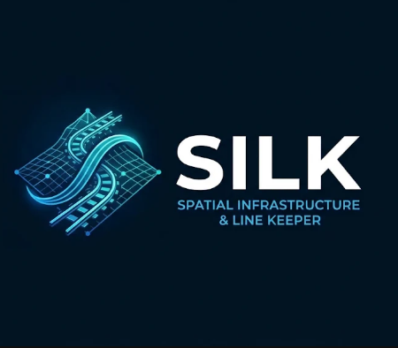
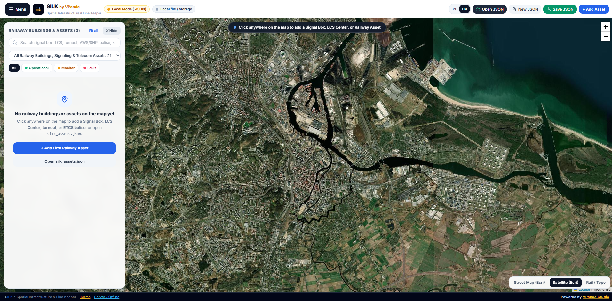
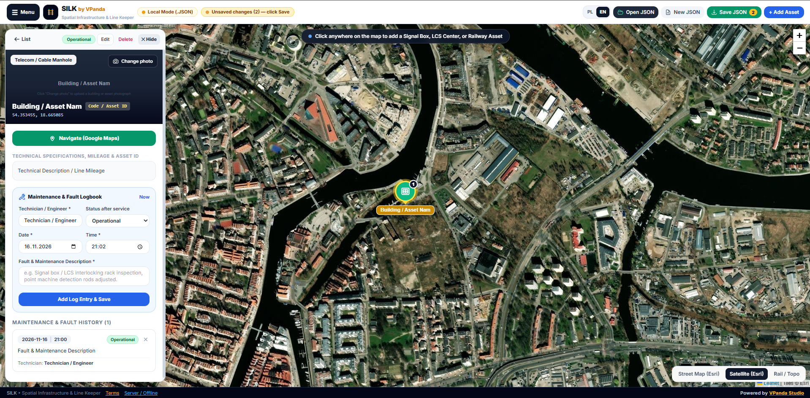
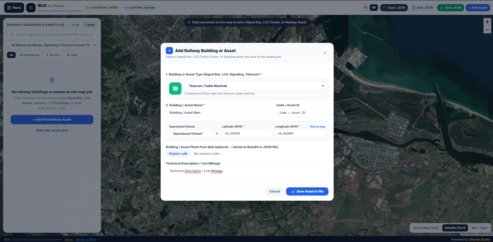

<div align="center">
  
  <h1>SILK by VPanda</h1>
  
  <p><strong>Spatial Infrastructure &amp; Line Keeper</strong></p>
  
  <p>
    
    
    
  </p>

  <p>
    Interactive GIS &amp; Maintenance Management Web Application designed for Railway Signaling (SRK), Power, and Telecom Infrastructure.
  </p>

  <br />

  [**🌐 Open Live Demo (GitHub Pages)**](https://vezyyy.github.io/SILK-by-VPanda-Studio/SILK/silk-railway-gis/)

  <br />
</div>

---

## 📌 Overview

**SILK (Spatial Infrastructure & Line Keeper)** is a lightweight, browser-based GIS asset management and maintenance logbook application tailored for railway infrastructure, signaling (SRK), power supply, and GSM-R telecommunication teams.

The application uses a modular frontend structure (`index.html`, `style.css`, `script.js`) and features a **hybrid architecture**: upon startup, it attempts to synchronize with a configured REST/JSON server endpoint and seamlessly falls back to **100% offline local mode** using local `.json` database files and browser storage (`localStorage`).

---

## 🖼️ Screenshots

> *Note: All screenshots below show simulated demo entries with fictitious coordinates for demonstration purposes.*

<div align="center">
  
  <p><em>Main GIS map interface with collapsible asset drawer and status-coded markers</em></p>
</div>

| Asset Details & Maintenance Logbook | Adding a New Railway Building / Asset |
| :---: | :---: |
|  |  |
| *Service logbook & one-click Google Maps GPS routing* | *21 specialized railway categories (Signal Boxes, LCS, Containers, Crossings, SRK, GSM-R)* |

---

## ✨ Key Features

- **21 Specialized Railway Asset & Building Categories:**
  - Technical Containers / Equipment Shelters (*Kontener techniczny / Szafa aparaturowa*) and Level Crossings Non-SSP (*Przejazd kolejowo-drogowy Nie-SSP*)
  - Signal Boxes (*Nastawnia*) & Local Control Centers (*LCS*)
  - Railway Turnouts & Point Machines (*Rozjazdy / Napędy EOR*)
  - Interlocking Controllers (*Sterowniki SRK / PLC*), Color-Light Signals (*Semafory*), Shunting/Distant Signals (*Tarcze Tm/To*)
  - Trackside Train Protection: AWS/SHP Track Magnets, ETCS Eurobalises, Axle Counters (*Liczniki osi*), Level Crossing Protection (*SSP*)
  - Wayside Cabinets, LV Power Switchgear (*Szafy energetyczne*), Overhead Catenary Masts (*Słupy trakcyjne*), Electric Point Heating (*EOR*), Derailers (*Wykolejnice*), WILD/DSAT Detectors
  - GSM-R Telecom Towers & Underground Cable Manholes (*Studzienki telekomunikacyjne*)
- **Authentication & Demo Mode:** Login modal with optional server `/login` verification, **Demo Mode** for offline `.json` work, and session logout (`Wyloguj`).
- **Live GPS Tracking & Field Entry:** Real-time user position tracking on the map with accuracy circle and one-click asset creation at current GPS coordinates.
- **Maintenance & Fault Logbook:** Chronological service history per asset with date, time, role/position selector (*Automatyk*, *Drogowiec*, *Dyżurny Ruchu*, *Zawiadowca*, *Naczelnik*, *Inny*), author signature, operational status (`Operational`, `Monitor`, `Fault`), multiple compressed JPEG photo attachments stored in JSON, and full-screen image lightbox preview.
- **Direct GPS Navigation:** One-click integration with **Google Maps Directions** to route field technicians directly to any trackside asset.
- **Multi-Layer Map View:** Responsive layer switcher (dropdown on mobile, quick buttons on desktop) between Street/Rail Map (Esri), High-Resolution Satellite Imagery (Esri World Imagery), and Topographic Rail Map (OpenTopoMap) — no API keys required.
- **Bilingual Interface:** Instant switching between **Polish (PL — default)** and **English (EN)**.
- **Hybrid Server & Local `.JSON` File Sync:** Merging incoming `.json` files with current assets, direct read/write via the File System Access API, or timestamped download fallback (`silk_DD-MM-YYYY_HH-MM_assets.json`) plus optional REST API synchronization.

---

### 🔒 Critical Infrastructure Security Notice

**WARNING:** This public repository contains only the source code of the application and does not include any real railway infrastructure coordinates or operational data.

Users are strictly prohibited from uploading, sharing, or committing `.json` export files containing real coordinates, technical parameters, photographs, or fault records of critical railway infrastructure to public repositories.

---

### 🚀 Running the Application

- **Online (GitHub Pages):** Open repository **Settings → Pages**, select **Branch: main**, folder **/ (root)**, and click **Save**.
- **Locally / Offline:** Clone or download the repository (keeping `index.html`, `style.css`, `script.js`, and `assets/` in the same directory structure) and open `index.html` directly in any modern browser (Chrome, Edge, Firefox, Safari) or via a local web server.

---

## 🗂️ Project Structure

```text
SILK-by-VPanda-Studio/
├── index.html                   # Main HTML layout, modals & UI structure
├── style.css                    # Custom layout, scrollbars, marker & animation styles
├── script.js                    # Auth/demo mode, map logic, GPS, logbook, lightbox & JSON sync
├── site.webmanifest             # PWA web manifest
├── assets/
│   ├── SILK_Logo.png            # Application & splash screen logo
│   ├── VPanda Logo2.png         # Studio logo
│   ├── favicon.ico              # Browser tab icon
│   ├── screenshot-map.png.png   # UI preview — map & drawer
│   ├── screenshot-details.png   # UI preview — maintenance logbook & GPS navigation
│   └── screenshot-modal.png     # UI preview — asset creation modal
├── .gitignore                   # Prevents accidental upload of sensitive .json asset files
├── LICENSE                      # MIT License
└── README.md                    # Project documentation
